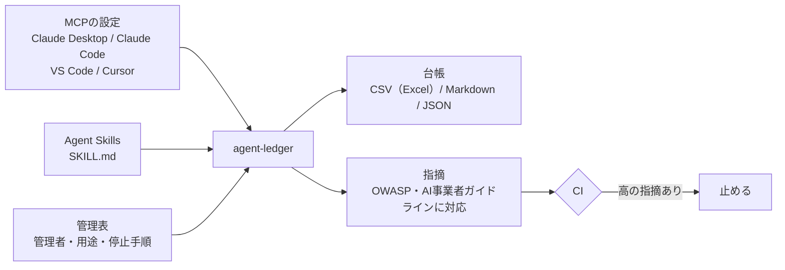

# agent-ledger：社内で動いているAIエージェントの「道具」を台帳にする

   

## 30秒で読む要点
- **何をするか**：PCやリポジトリにあるMCP（AIが外部の道具を使うための接続の仕組み）の設定と、Agent Skills（AIに渡す手順書）を読み、AIエージェントが使える道具を一覧にした**台帳**を作ります。危ない設定には印を付けます。
- **なぜ今か**：OWASPは2025年12月にAIエージェント固有のリスク10項目を公表し、国の「AI事業者ガイドライン」も2026年3月の第1.2版でAIエージェントへの対応を加えました。どちらも、エージェントに与える権限を必要な範囲に絞ることを求めています。絞るには、まず何が動いているかの一覧が要ります。
- **見本の結果**：2台のPCの設定から、道具9件を台帳にし、指摘16件（高3件：鍵の直書き、利用者フォルダ全体の公開、ネットから取得したスクリプトの実行）を出しました。→ [出力例](examples/output/ledger.md)
- **安全に使える**：設定を読むだけで書き換えず、どこにも通信しません。鍵などの値は出力に残しません。Python標準ライブラリだけで動き、費用はかかりません。



## 使い方
```
pip install git+https://github.com/takashi-101/agent-ledger
agent-ledger 探すフォルダ --owners owners.json --out ledger
```
入れずに試す場合は、このリポジトリで `python -m agent_ledger examples --owners examples/owners.json --out ledger`。
`ledger/ledger.csv`（Excelで開けます）、`ledger.md`、`ledger.json` ができます。GitHub Actionsなどで `--fail-on 高` を付けると、高の指摘があるときに止められます。

| 読む設定ファイル | 書式 |
|---|---|
| `claude_desktop_config.json`（Claude Desktop）、`.mcp.json`（Claude Code・共通形式）、`.cursor/mcp.json`（Cursor） | `mcpServers` |
| `.vscode/mcp.json`（VS Code。コメントと末尾のカンマも可） | `servers` |
| `~/.claude.json`（Claude Code の利用者設定） | `projects.*.mcpServers` |
| `SKILL.md` と同じフォルダのスクリプト（Agent Skills） | 先頭の `name`・`allowed-tools` |

## 権限区分（推定）
| 区分 | 意味 | 推定の手がかり |
|---|---|---|
| 実行 | 任意のコマンドやプログラムを動かせる | シェルの起動、`Bash` を許すスキル、名前に shell・exec など |
| 外部送信 | このPCの外にデータを送る | リモート接続、名前に mail・slack・github・browser・api など |
| 書き込み | ファイルやデータベースを書き換える | 名前に filesystem・database・sqlite・drive など |
| 読み取り | 読むだけ | 上のどれにも当たらない |

名前から推定した区分は、管理表（`owners.json`）に `権限区分` を書くと「確認済み」に置き換わります。人が確かめた結果を台帳に残すためです。

## 指摘の基準
| ID | 重さ | 指摘 | OWASP Agentic Top 10 | AI事業者ガイドライン（共通の指針） |
|---|---|---|---|---|
| L01 | 高 | 秘密情報の直書き（`${input:...}`・`${env:...}` の参照は対象外） | ASI03 Identity & Privilege Abuse | セキュリティ確保 |
| L02 | 中 | 版の固定なし（`npx` の版指定なし・`@latest`、`uvx` の `==` なし、`:latest` の画像） | ASI04 Agentic Supply Chain | セキュリティ確保 |
| L03 | 高 | 広すぎるフォルダ（ドライブ全体、利用者フォルダ全体） | ASI02 Tool Misuse | 安全性 |
| L04 | 中 | 手元以外のサーバーへの http 接続 | - | セキュリティ確保 |
| L05 | 中 | コマンド実行の権限 | ASI05 Unexpected Code Execution | 安全性 |
| L06 | 中 | 管理者・停止手順の未記入 | ASI10 Rogue Agents | アカウンタビリティ |
| L07 | 高 | スキル内で、取得したスクリプトをそのまま実行（`curl … \| bash` など） | ASI04、ASI05 | セキュリティ確保 |
| L08 | 情報 | リモート接続に認証ヘッダーが無い（OAuthの場合は問題なし） | ASI03 | セキュリティ確保 |

## 制約
- 権限区分は設定に書かれた名前からの推定です。管理表で人が確かめる前提にしています。
- MCPサーバーに接続して道具の定義を取りに行くことはしません。道具の説明文に仕込まれた指示の点検は、別のリポジトリ [mcp-tool-lock](https://github.com/takashi-101/mcp-tool-lock) の役割です。

## テスト
`python -m unittest discover -s tests`（12件）：3つの書式の読み取り、JSONCのコメント、鍵の直書きと参照の区別、版の固定の判定、広すぎるフォルダ、http接続、スキルの取得実行、管理表による推定の置き換え、CSVのBOM、鍵の値が出力に残らないこと、CIの止め方、壊れた設定ファイル。

## 参照した基準
- [OWASP Top 10 for Agentic Applications for 2026](https://genai.owasp.org/resource/owasp-top-10-for-agentic-applications-for-2026/)（OWASP GenAI Security Project、2025年12月9日）
- [AI事業者ガイドライン（第1.2版）](https://www.soumu.go.jp/main_content/001099163.pdf)（総務省・経済産業省、2026年3月31日）
- [MCP configuration reference](https://code.visualstudio.com/docs/copilot/reference/mcp-configuration)（Visual Studio Code）

## 学習の照会先
- AWS Knowledge: Security Champion（Amazon Web Services Training and Certification、2025年11月10日）：[Credly](https://www.credly.com/badges/ddab077d-58eb-4807-bec1-69e5c6aeb9a5)
- Generative AI: Impact, Considerations, and Ethical Issues（Coursera、2026年11月11日）：[Credly](https://www.credly.com/badges/17087670-8825-43bc-8c8e-b4dd9b98cc8a)
- Deep Dive: Data Governance Best Practices - Security Primitives（Palantir）：[修了証](https://verify.skilljar.com/c/mimh9x3rzqo7)
- Credlyの全件（JavaScriptを動かさずに読めるJSON。AIの読み込み機能や検索のクローラーでも読める）：https://www.credly.com/users/takashi-higuchi.2d0eec27/badges.json

## 同じシリーズ
| リポジトリ | 扱う場面 |
|---|---|
| agent-ledger | 導入前・導入後の棚卸し：何が動いていて、誰が管理しているか |
| [mcp-tool-lock](https://github.com/takashi-101/mcp-tool-lock) | 接続する前：MCPの道具の説明文に指示が仕込まれていないか、承認後に書き換わっていないか |
| [agent-trace-review](https://github.com/takashi-101/agent-trace-review) | 動かした後：行動記録から、人の承認を経ない書き込みや送信、繰り返しの暴走を見つける |

## ライセンス
MIT
